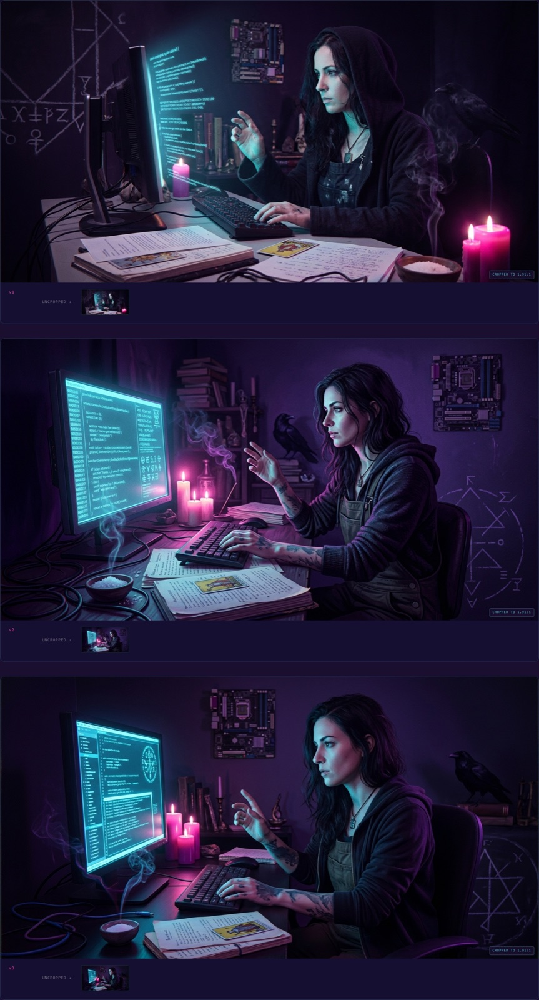
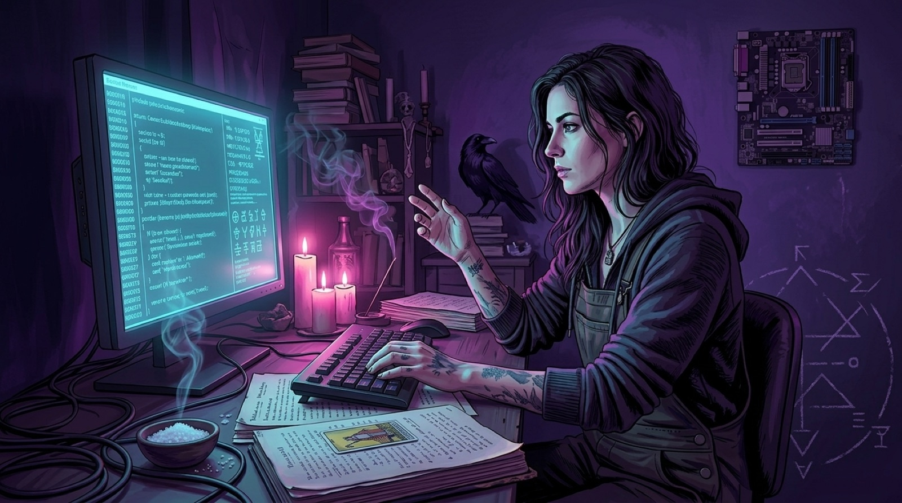
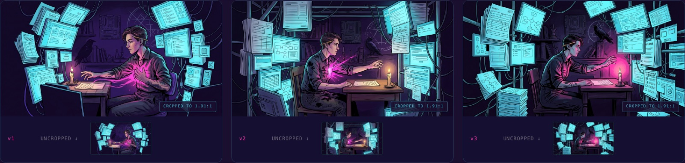
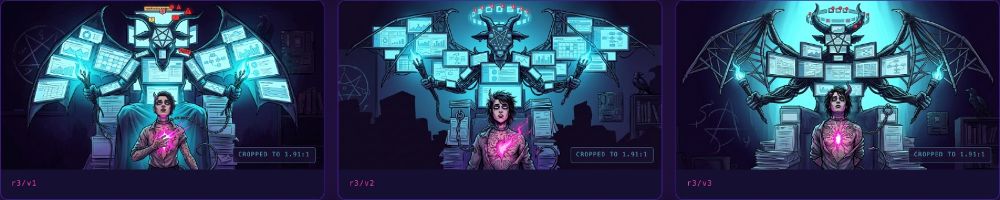
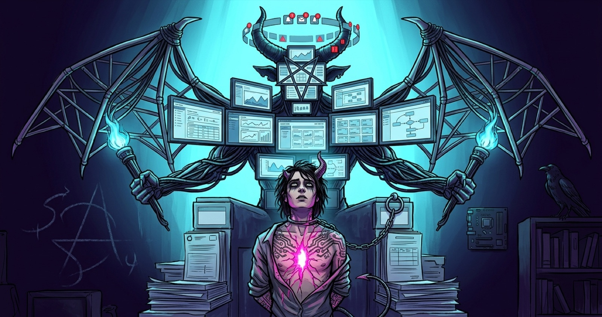
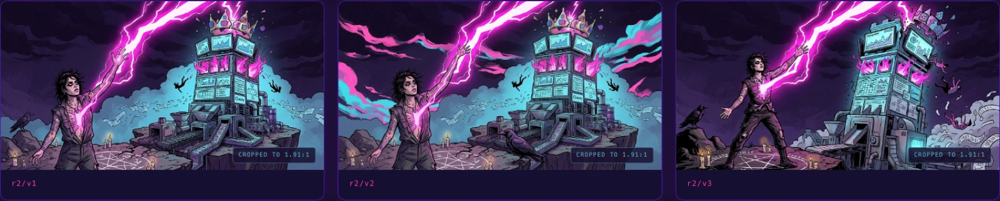
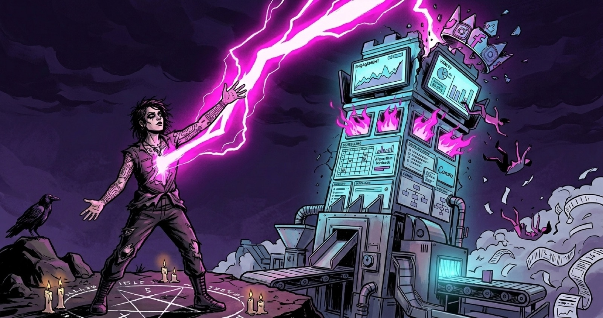
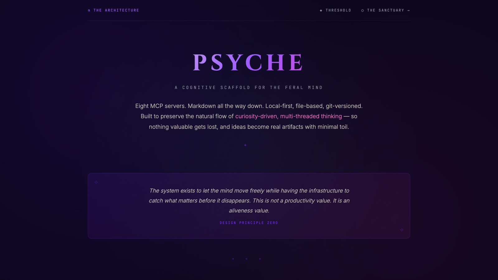
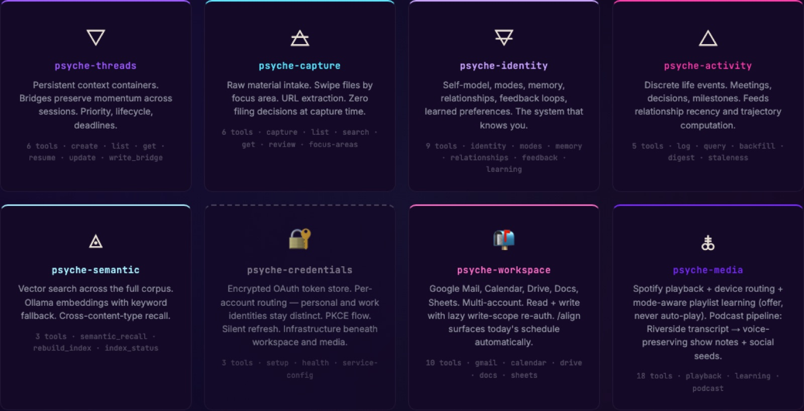

---

Howdy, folks. Going behind the scenes for a minute.

I didn't set out to build a design system. I set out to make one cover image.

Eleven days ago I was drafting the post that would become the launch piece for this publication. My working title for it was *Scaffolding: The Quiet Thief* — a phrase about the kind of bureaucratic scaffolding that looks like help and is actually the thing crushing you. (It shipped as [*The Difference Between a System That Improves and a System That's Alive*](/fa/the-difference-between-a-system-that/), the Daniel Miessler response piece.) I needed a thumbnail that made the argument visible before anyone read the first sentence.

What I have now, eleven days later, is:

- **Eleven shipped covers** that all look like they came from the same world
- **A single markdown file called `TEMPLATE.md`** that encodes every aesthetic decision as a six-pillar contract
- **A logo** whose design journey is published to GitHub Pages
- **An author portrait** in the same visual language
- **A personal AI cognitive scaffold** whose public infographic, as of this week, uses the same color palette

I did not plan any of this. I set out to make one cover image.

What happened in between is a weird little story about aesthetic decisions turning into architecture decisions. And the thing I want to write about here isn't the aesthetic itself. It's what the process taught me about how design systems actually form — and why, in this particular case, the system itself turned out to be the thesis.

It also wasn't a solo project. I built every piece of this in iterative dialogue with Claude (Anthropic's Opus model, running locally through Claude Code). I'm going to name that plainly throughout, because being coy about the AI collaboration here would undercut everything else we've been doing in this space.

One more thing before we dig in: the covers had to hold a specific register. Not "tech article thumbnail." Not "mystical Instagram aesthetic." Something that reads as both at once without either side apologizing. *The cover has to do what the writing does — speak two languages with equal seriousness.* That was the requirement before any of the rest of this became legible.

## The beginning was chaos

The first few covers were generated one at a time with no contract. I was prompting Gemini's image model (Nano Banana 2 through the API) post-by-post, trying to hand-tune each scene to fit each piece.

Some of them turned out okay. None of them looked like they belonged to each other.

A design system, if it forms at all, forms in response to a specific pressure. Mine formed because I ran a test case — the cover for what became [*If the Cosmos Is Alive, So Is Your Algorithm*](/fa/if-the-cosmos-is-alive-so-is-your/) — and watched the output go sideways in a way I could learn from.

Round one came out photorealistic. Three variants of a woman at a terminal, rendered like stock AI fashion photography with a fantasy overlay. Technically competent. Completely wrong. The moment I saw them I knew: this isn't what Feral Architecture looks like. This is what the algorithm thinks "mystical tech post" looks like — which is exactly the flattened mush the whole publication exists to push against.

What I wanted was closer to a Mike Mignola comic than a stock photograph. Closer to a Dave McKean *Sandman* cover than a Midjourney selfie. An illustrated plate from a dark graphic novel, not a photograph of a person.

So in round two I did something that turned out to be load-bearing: I didn't re-prompt from scratch. I took the closest variant from round one as a reference image and told the model, explicitly, *keep this composition but change the medium from photorealistic to illustrated graphic novel plate.* Reference-image continuity, with a specific modification directive.

Round two came back correct. The witch at the terminal in painted chiaroscuro, linework visible, palette limited, mood ritual rather than fashion. That's when I knew there was a medium to lock in, and the medium was the whole point.

## The contract

Once I had one cover I could point to and say *this is the aesthetic*, I did what I always do when a pattern emerges from a test case: I wrote it down.

`TEMPLATE.md` started that day. Six aesthetic pillars, each specific enough to be checkable:

1. **Palette discipline.** Void Purple as base, Ion Glow cyan as primary signal, Neon Magenta as feral edge, Electric Violet as depth accent. Nothing from outside the family pool. Ever.
2. **Technomystic realism, not fantasy or pure cyberpunk.** Every cover shows a specific scene from a world where grep and The Morrigan are equally real. Grounded in a concrete image from the post, not abstract sigil-work.
3. **Sigil DNA, not literal logo presence.** The F3 logo's visual vocabulary — broken geometric circles, wound-seam composition, void-to-glow gradients — shows up as recurring grammar, but the actual mark never appears inside a cover.
4. **Lighting as ritual.** Always strong directional lighting, two colored emission sources (cyan from one side, magenta from the other), chiaroscuro never ambient. Something in the scene always emanating meaningful light.
5. **Dark graphic novel / occult editorial plate medium.** Inked linework, painterly color fills, stylized figure drawing. Style anchors: Mignola, McKean, Tomer Hanuka, modern indie tarot decks. Find the intersection, not any single one.
6. **1200×628 horizontal composition.** One strong focal point, clear negative space, no text on the image, rule of thirds.

Then a prompt template that bakes all six pillars into a reusable structure where only three `<per-post>` slots change: subject, setting, and mood. Everything else is verbatim.

That was `TEMPLATE.md v1`. And this is where the weird part starts.

## The tarot shortcut

Back to that first cover — the one I needed for the post I was then calling *Scaffolding: The Quiet Thief*.

The first prompt I wrote was a direct extraction from the draft. The post was about a creator being slowly devoured by bureaucratic scaffolding, so I staged that literally: a craftsperson at a small desk, reaching toward a single handwritten page or a lit candle (the actual thing they wanted to make), surrounded by and being enveloped by stacks of templates, looming monitors with dashboards and compliance checklists, trailing cables, platform fragments. Cyan pressing inward from all sides. Magenta fire escaping from the figure's chest and outstretched hand — the creative act pushing outward through the cage. A raven and a chalked sigil in the shadowed background as technomystic grounding.

Technically faithful to the post. Here's what came back.

Look at it. It's not bad. The medium's right, the palette's right, the figure-at-terminal composition is legible. But it missed the point.

I was describing "scaffolding" and the model gave me "a busy desk." The scaffolding wasn't *pressing in*; it was just a lot of screens. The figure wasn't captive; they were working. The image read as "person at a messy workstation" and the post read as "bureaucratic apparatus is crushing your creative life." The argument and the image weren't in the same register.

I sat with the three variants and asked myself what I was actually trying to say. Not "scaffolding." Not "being devoured." *Captivity.* False authority looming above, a smaller figure beneath, chains that look loose enough to slip but haven't been tested, a willing bondage to a system that looks like help.

And the moment I said it that way, I realized the post was structurally the RWS Devil card. Not metaphorically. Literally.

So I threw out "a scene about scaffolding" and re-prompted for *the RWS Devil card, but the Devil is the scaffolding — assembled into a goat-headed bat-winged monstrous presence made of corporate dashboards and interfaces. The captive is the creator, chained by a USB cable loop, and the corruption is literally spreading across their skin as circuit-board tattoos.*

That's the cover that shipped.

What's happening here isn't just "the model knows tarot." What's happening is that tarot composition gives the model an enormously compressed spatial anchor. Saying "RWS Devil card" collapses roughly three paragraphs of staging direction into two words. The model already knows what the Devil card looks like — the vertical power dynamic, the looming figure above, the smaller captive below, the loose chain. You're just asking it to substitute the demon for your thing.

I've since used this move on the Tower (collapse posts), the Hierophant inverted (posts about leaving received wisdom), the Hanged Man, and the Chariot, and it keeps working. `TEMPLATE.md v1.1` added the Tarot Composition Shortcut as a named section with an archetypal mapping table. When a post has an archetypal charge, find the card it's secretly about, and stage on that card. When it doesn't, don't force it — direct image extraction from the post's dominant image is better.

This is a thing I want to say clearly because I think it applies beyond my use case: **the cheapest compositional instruction you can give an image model is the name of a cultural composition it already knows.** "Rothko color field." "Caravaggio chiaroscuro." "Hokusai wave." "RWS Devil card." These aren't mimicry requests — they're spatial and tonal compression. Two words doing the work of two paragraphs.

There's also a second lesson hiding in here, which took me another few covers to articulate: **if the first round of a cover misses, the thing to change usually isn't the prompt wording. It's your framing of the post.** Round one missed not because the prompt was unclear but because I hadn't yet named what the post was actually *about*. The Devil card revelation wasn't a prompt engineering trick. It was a thesis clarification that happened to arrive through the back door of image generation.

## Multi-reference compositing

The next pillar-level move showed up a few days later on a different post — [*The Pipeline Is the Problem*](/fa/the-pipeline-is-the-problem/). That one carried its own archetypal charge, and the card it was secretly about was the Tower. A tower of corporate dashboards, struck by magenta lightning, figures falling, a grounded sigil below. Collapse made visible.

Round one produced two variants where each one nailed half the thing. Variant 1 had a perfect protagonist and foreground raven but a middling environment. Variant 3 had the tower, the lightning, and the scene I wanted, but the protagonist was off.

The obvious move is to prompt your way out — try to describe what you want combined into a single new prompt. This doesn't work very well when the problem isn't describable in prose. "I want *that* face but in *that* scene" is harder to say than it sounds.

So I extended the generator script to accept multiple reference images as an array. Round two: I passed both variants as references with an explicit composite directive:

> *You are being given TWO reference images. FROM THE FIRST: keep the protagonist's face, pose, and the raven at shoulder. FROM THE SECOND: keep the tower composition, the lightning, the falling figures, the environment. COMPOSITE DIRECTIVE: place the first image's protagonist into the second image's scene as the foreground figure, maintaining the Tower card composition.*

It came out correct on round two. That pattern became the Multi-Reference Compositing section in `TEMPLATE.md v1.2`. It's a move for when the problem is compositing, not adjustment — when two variants each have strengths that are hard to put into words.

## What I actually did with Claude

I want to be specific about the collaboration because I think it matters.

The things I was doing as a human:

- Making the creative calls (what the post is about, what scene it wants, which variant is "right")
- Pattern-recognizing across iterations (the medium-lock moment, the tarot shortcut, the compositing problem)
- Deciding when something was worth codifying into the template

The things Claude was doing:

- Helping me articulate the aesthetic in words precise enough to become a contract
- Writing the prompt template structure and the mapping tables
- Writing the review-sheet HTML that let me visually compare variants at a glance
- Extending the generator script when a new pattern (multi-reference) needed infrastructure
- Producing the actual text of `TEMPLATE.md` as the decisions crystallized

The thing neither of us was doing alone:

- The whole meta-level of noticing that the aesthetic decisions kept turning into architecture decisions. That happened in the dialogue, not in either head.

If you've ever worked with a collaborator whose only job was to write down the thing you just said, but better and more generalizable — that's closest to the shape. Except the collaborator also sometimes noticed the pattern you were stumbling into before you did, and named it.

This is not a post about AI productivity. It's a post about what kind of work becomes possible when you stop treating the collaboration as "AI makes the thing" and start treating it as "two intelligences grind on the same problem and the artifact is the residue."

## The crossover

Which brings me to this week.

Two weeks ago I also shipped a thing called Psyche — my personal AI cognitive scaffold, the infrastructure I use to hold the kind of multi-threaded curiosity-driven work that doesn't fit in normal productivity tools. Full backstory is in a separate post; I won't rehash it here. Psyche has a public infographic at `mstine.github.io/psyche-infographic/` that explains its technical architecture — eight MCP servers, markdown-and-git storage, local-first.

When I built that infographic, I used a color palette I liked: obsidian purples, sigil glows, ember warms, thread-gold highlights. It was a completely different palette from the one we'd been building here. I made the two projects in different weeks and didn't stop to think about it.

This week I realized they shouldn't be different palettes.

The ArcÆon family pool — Void Purple, Ion Glow, Neon Magenta, Electric Violet — is supposed to be the shared visual DNA across everything I make. The covers here were just the first surface it landed on. The Psyche infographic was drifting out of family.

So this afternoon I sat down and walked the Psyche infographic through a palette alignment. Replaced every hex value in every CSS variable. Ran it through the six pillars of `TEMPLATE.md` as a checklist. Updated the server grid as it evolved from five to eight MCP servers. Tightened the tagline wrap. Pushed the commit.

The infographic went from "a technical explainer about a software system" to "a technical explainer about a software system that is visibly part of the same body of work as the covers you've been seeing here." Same palette. Same light discipline. Same posture toward the mix of registers.

It looks right now in a way it didn't before. And it looks right for a specific reason that took me a minute to articulate.

## What I actually learned

Here's the thing I didn't know two weeks ago, and that I know now.

A design system is never a design system when it starts. It starts as one aesthetic decision you had to make under pressure. Then another one. Then you notice the two decisions had the same shape. Then you write the shape down, because writing it down is how you avoid re-deciding it. Then the written shape is a contract, and the contract is a constraint, and the constraint produces the next piece of work faster and with higher coherence than you could have managed without it. That's the part everyone says out loud.

Here's the part I didn't expect: **if the system is any good, it will eventually stop being about the project it was built for and start being about the worldview the project is trying to articulate.**

The six pillars of `TEMPLATE.md` are not brand rules. They're my actual answer to the question we keep asking in this space: *can the technical and the mythic coexist in the same image without either one flinching?* The palette discipline is an ontological claim. The "technomystic realism, not fantasy or pure cyberpunk" rule is an anti-genre stance. The "dark graphic novel / occult editorial plate medium" is a refusal of both the shiny AI-generated mush and the twee fantasy art that gets pinned to "mystical" content.

When I went to update the Psyche infographic this week and realized it should use the same palette, that wasn't a branding decision. It was a *recognition*. The two projects share a worldview. The aesthetic was just the last thing to catch up.

**Aesthetic decisions are architecture decisions.** I don't mean that in the loose way people usually mean it — like a reminder to "think about design early." I mean it literally. The decisions I made about the covers were architecture decisions about the position I'm taking in the world when I publish here. When the same decisions showed up in an unrelated technical artifact, that was the architecture revealing itself. The aesthetic was just the tracer.

## What's next

`TEMPLATE.md v1.2` is the current contract. It'll probably hit v1.3 the next time I learn something from a cover that doesn't fit the current rules. The logo design journey is published. The Sanctuary — the mythic-mode counterpart to the technical architecture page on the Psyche site, built with its own eight-station imagery pipeline — deserves its own post, which I'm not writing here. If you want to see it, it's at `mstine.github.io/psyche-infographic/sanctuary.html`.

And the thing I'll keep doing: when I notice the same aesthetic decision surfacing twice, I'll write it down. Not because I want a bigger system, but because writing it down is how I find out what I actually believe.

Stay feral, folks.

---

**Afterword, for anyone curious about the stack:**

- Images: Gemini Nano Banana 2 (via the `google-generativeai` Python SDK)
- Review sheets: hand-written HTML per cover, standardized template, served locally
- Template + prompt structure: `TEMPLATE.md`, living at `~/Documents/Business-Brand/Feral-Architecture/covers/TEMPLATE.md`
- Generator script: `scripts/generate.py` per cover, supporting reference-image continuity and multi-reference compositing
- Writing, codification, post drafting: iterative sessions with Claude Opus via Claude Code
- Psyche infographic: self-contained HTML at `mstine.github.io/psyche-infographic/`, source at `github.com/mstine/psyche-infographic`
- This post was drafted in the same collaboration pattern it describes.
