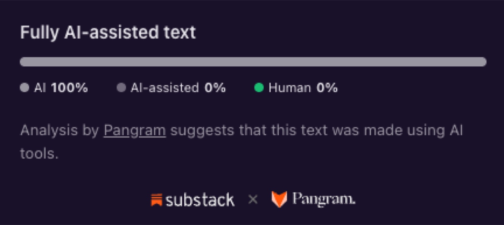

On July 21, Substack put a lie detector in your pocket. Anything published on this platform since — post, Note, reply, comment, a hundred words or longer — can be scanned with a tool called Pangram, which hands you a number estimating how much of the text was written by hand and how much with AI assistance. The announcement came from the CEO himself, complete with a new word for the crime it's hunting: *Claudefishing*. Reading something you believe came from a human when there was "no human thought on the other end."

You have that scanner. And you are, statistically speaking, at least a little curious what it says when you point it at me — the person who writes with a machine and says so, on purpose, in public.

So I'll save you the scan. I ran this piece through Pangram before I published it:

And here's the thing I need you to sit with: whatever number it handed back, it was going to be wrong.

Not wrong on the arithmetic. Pangram is, by most accounts, good at its job. Wrong the way the old water test was wrong. You remember the design: bind the accused, throw her in the pond. If she floats, the water has rejected her — witch, light the fire. If she sinks, she was innocent. Also, she's drowning. The genius of the mechanism: it could not exonerate. Every outcome confirmed the accusation was worth making.

Now run me through it. I write with a machine and I say so. If the scan comes back AI, I float — burn me. If it comes back human, then the scanner just walked past the machine I openly use, the test failed at the one job it has — and somehow I'm still wet. There is no result that produces information. That's not a detector. That's a dunking stool with a confidence score.

## The crime is real

Let me be clear about what I'm not doing, because the AI-discourse bingo card has a square for it: I am not about to tell you the whole thing is a moral panic.

The announcement quotes Freddie deBoer: "I access human-made art because I know there's a human behind it and that's what I'm looking for, other humans, showing me in art what they hide in their selves. Fooling me in that process is just a con."

He's right. It is a con. When you pour attention into words and there was never anyone on the other end — no person who meant them, chose them, would stand behind them — something real was stolen from you.

I've already conceded this, at length, in public. [Provenance is sometimes part of the object](/fa/provenance-is-part-of-the-object/). The reader-writer pact is real. Aura is real. I built a whole essay around granting the phenomenological objection its full weight, because it's the strongest one in this conversation.

So no walk-back. Substack named a real crime. The con exists, the con is bad, and the con is getting cheaper to run every quarter.

The problem is what they built to catch it.

## Two weeks of return fire, and nobody answered the question

The response pieces came fast, and some of them are genuinely good. Within two weeks they'd sorted into a taxonomy.

**The brittleness lane: deBoer** — yes, the same deBoer quoted in the announcement — had published [a teardown of Pangram](https://freddiedeboer.substack.com/p/i-wouldnt-say-pangram-is-broken-but) on July 19. Two days *before* the launch post. Same passage scanned alone, scanned in pieces, scanned inside a longer essay: different verdicts. Pangram's founder showed up in his comments the next day and, credit where due, conceded the failure mode. On day three, Substack published its announcement, quoting deBoer as the moral authority for the feature — and not linking the teardown. The witness for the prosecution was already the tool's most prominent skeptic.

**The wrong-variable lane:** Renee DiResta pointing out that detecting method tells you nothing about impact. Sam Illingworth — whose response is literally titled "Substack's AI Detector and the Return of the Witch Hunt," a man after my own heart — ran his own writing through a free "humanizer" and watched the verdict flip from 100% AI to 100% human. His line: "A score that shifts when you add or remove a tool is measuring tools, while the person who wrote the sentences stands right here, unmoved." 

**The structural lane:** Denis Stetskov noting that Substack spent two years coaching writers on posting cadence, then shipped a verdict machine with no appeals process: "Between Pangram's verdict and its consequence on Substack there is nobody." The reader gets a number. The writer gets whatever the number decides.

All of it fair. Some of it sharp as hell.

But here's what I noticed. The announcement ended with two direct questions: *"When is AI use Claudefishing? When is it great?"*

I went looking for the answers. I read every response I could get my hands on — teardowns, autopsies, structural critiques. All of them argue about the detector. Not one answers the questions. They sat there in the road, unattended, exactly the way "if you like it" sat unattended when [I threw fourteen words at Threads](/fa/if-you-like-it-why-do-you-care/) and watched damn near everybody sprint past the premise to get to their prepared remarks.

I've seen this movie. Last time I was the one asking. Asking the question was the most honest move in that announcement — and the discourse treated it as decoration.

Fine. I'll answer.

## The empty chair and the power tools

Buried in the middle of the announcement, Substack confesses: "Note that Pangram can only detect whether AI was used to make the text, not whether great human care went into creating it, nor whether AI tools were used as a source."

Read that again. The crime they named is an *absent author* — attention invested with no human thought on the other end. The variable their scanner measures is *present tooling*. Those are not the same variable. They are not correlated the way the feature needs them to be. Claudefishing is an empty chair, and the scanner checks the desk for power tools.

A carpenter's chair doesn't stop being handmade because there's a table saw in the shop. And a ghost-farm churning out engagement bait was Claudefishing readers before the transformer architecture existed — the empty chair predates the machine that made it cheap.

If you want to know what the mismatch costs, you already have a casualty. This spring — before Substack ever licensed the tool — a 62-year-old Trinidadian writer named Jamir Nazir won the Caribbean regional round of the Commonwealth Short Story Prize, and the internet promptly convicted him of slop. The star evidence: Pangram. A research scientist at the company announced that three of the five regional winners, Nazir's story included, looked partly or wholly machine-made. Nazir has neuropathy from diabetes and cancer treatment that makes typing difficult; he often writes by speaking into his phone. The Commonwealth Foundation ran a month-long inquiry — early drafts, timestamps, interviews — and declared itself satisfied that no AI wrote the winning stories. He went on to win the whole damn prize. Kevin Kane wrote [the definitive piece](https://open.substack.com/pub/kevinkaneauthor/p/dead-audience-theory) on the accusation economy that formed around him.

Case closed? Not even slightly. The discourse kept litigating — interviews picked apart, the defense re-prosecuted — because the scanner started this and the scanner cannot end it. Everything that could actually settle it — drafts, timestamps, a man's testimony about his own hands — happened *outside* the tool, which rendered its number and had nothing further to say. Whatever the truth about that chair, the water test didn't find it. It produced a verdict without producing knowledge — and a verdict without knowledge is just an accusation with a percentage sign. Nazir's name and the word "fraud" now share a search-results page for the rest of his career. No scan can un-share it.

## The seam beneath the seam

The best response of the two weeks came from Carlo Iacono, who [distinguishes two seams](https://hybridhorizons.substack.com/p/the-wrong-seam) in AI-assisted work: the aesthetic seam between machine prose and your prose, which craft closes — and the ethical seam between what you made and how you present its origins, which only honesty closes. His line worth engraving somewhere: "A verdict asks to be trusted. An account asks to be tested."

That's the right frame. And I think there's a seam beneath his seam.

Accountability — someone who will answer for the sentence — is the *test*. But what the test is checking for is something more primal: whose thinking does this text carry? Provenance of thought, not provenance of keystrokes. A sentence can leave my mind through a keyboard, through dictation software, through a machine trained to hold my own corpus against my own standing instructions — and the only question is whether the thinking inside it is mine. Whether there's a self on the other end whose actual pattern-making you're in contact with.

That's the thing the reader was always paying for. Not hand-typed tokens. Contact.

## So: when is it Claudefishing?

When the chair is empty. When there is no one who can tell you why a sentence is there, because no one decided. When the words were optimized for an audience instead of meant for a reader. When you could ask "what did you intend by this?" and the honest answer is that nothing intended anything — a metric intended, a growth curve intended, a content calendar intended, and a language model was the cheapest way to feed it.

Notice that this definition doesn't mention tools. It can be committed with a model, with a plagiarized archive, with an underpaid content mill running on pure human labor. The machine didn't invent the empty chair. It dropped the price.

## And when is it great?

When the tool puts *more* of the person on the page, not less.

Here's mine, since we're doing this. I write with Claude. Not "I let Claude write" — I built a system around it: identity files that hold my values and voice, calibration samples from years of my own writing, standing instructions iterated until the output had to reckon with *me* to exist at all. The machine holds the corpus. I hold the fire. Here's this piece's paper trail: the machine mined the response discourse and fetched the receipts, argued with me about structure, and drafted against my corpus under my standing instructions. I chose the angle, killed the first title for insufficient teeth, and put my hand on every sentence that survived. If that arrangement disqualifies the essay, tell me which paragraph stopped being true.

I'll wait.

Why work this way? I've [answered that one before](/fa/did-you-make-it-yourself-fuck-no/), and the short version is that my gift was never wordsmithing. It's pattern-recognition across systems. For an AuDHD brain, the distance between the pattern seen and the pattern *said* has been the tax of my entire life — and this partnership collapses that distance. There is more of me reaching you right now, not less. The chair isn't just occupied. It's occupied by someone who finally got the furniture arranged right.

Substack shipped a second feature in that announcement, and it got a fraction of the attention the scanner got: a "How I make this" statement, where writers set expectations in their own words. That one they got right. That's account, not verdict. And I'm about to put it to a use I suspect nobody intended: when this piece publishes, its URL goes in that box. My process disclosure will be an essay explaining why the scanner sitting next to it can't measure what it claims to. Use the honest tool to file a complaint about the confident one.

## The witness stand

A crow can pick one human face out of a crowd and remember it for years — remember who fed it, who threw the rock. Ask a crow whether somebody's home behind a pair of eyes and you'll get an answer with receipts. The scanner can't do that. It has never met anyone. It takes the measure of prose, not of presence — and presence was the entire question.

So here's the test Substack should have built, and the one I'll sit for. Not a lie detector. A witness stand.

Ask me why any sentence in this piece is here. Any of them. I'll tell you what it's doing, what it replaced, why it survived revision when its siblings didn't. Ask the empty chair the same question and listen to the silence. That's the whole difference — [it was never the machine, it's whose soul is driving](/fa/the-slop-and-the-sovereign/) — and no scan in the world can run that test for you. You have to ask.

I just answered. Your move, and the chair's.

And if the water rejects me anyway — well. I've been called a witch before. I answer to it.

Stay feral, folks.
