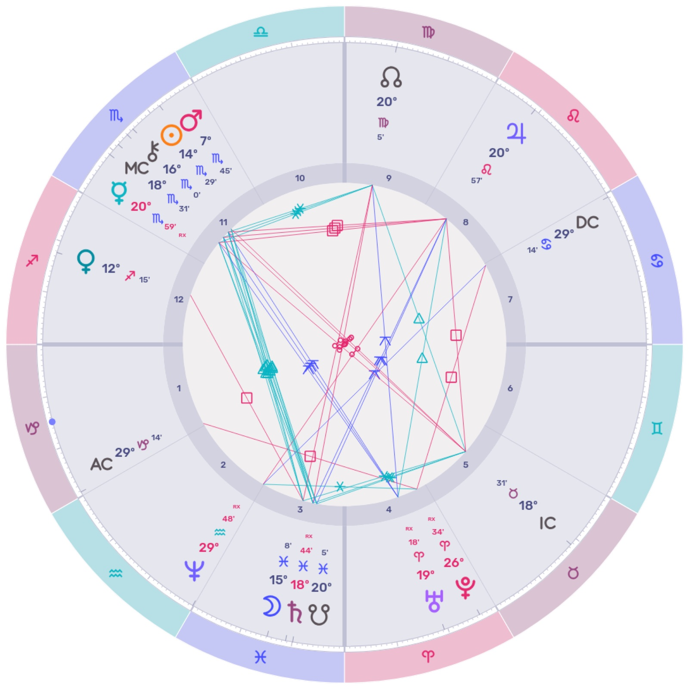

Howdy, folks.

Last piece established chart-as-analytical-scaffolding as a methodology. This piece runs it at the institutional scale to show what the methodology actually does in practice.

The institution in question is the University of Mississippi, and the disclosure is load-bearing: that's where I went to college. I'm downstream of the chart I'm about to walk through, the way the rest of the cohort that came through Oxford is downstream of it. The personal stake is what keeps this from being an analytical exercise about a school I don't know. It is also what forces the writing to confront the material with skin in the game rather than academic distance.

This isn't an alumni memoir. It's a case study in feral institutional architecture, with the chart as the analytical scaffolding. The methodology applies generally; Ole Miss is a clear demonstration vehicle because its contradictions are visible. Most institutions carry the same kind of pattern but better camouflaged. The point of this piece is the methodology and the operational edge it gives you on the institutions you're inside. Ole Miss is the demonstration, not the destination.

So here's the chart.

## The founding chart — 1848 inside the applying Uranus-Pluto conjunction.

The Mississippi Legislature chartered the university on February 24, 1844. Lafayette County residents donated land in 1845, and architect William Nichols oversaw construction of the Lyceum and supporting buildings through the mid-1840s. The institution opened its doors on November 6, 1848, with a first class of eighty students, almost all of them from Mississippi, and a curriculum designed for the education of the sons of the planter class. For the chart-as-scaffolding methodology, the operational opening is the load-bearing date — that is when the institution became live as an organizational entity, when its first lectures, decisions, and self-shaping actions began. By the time those first lectures were being delivered, Uranus and Pluto were already in applying conjunction at the end of Aries. The exact conjunction would hit three times — at 29°40' Aries on June 26, 1850; at 29°21' Aries on September 25, 1850; and at 28°43' Aries on March 23, 1851. Ole Miss opened in the gathering pressure of that aspect.

*Chart calculated for noon, November 6, 1848, Oxford, Mississippi — the institution's opening date. The exact time of the first lecture is not in the public record; the Ascendant and house cusps in this chart are accordingly approximate. The Sun, Moon, and outer-planet positions are accurate to within the resolution the argument requires.*

The atmosphere around the founding tells you what the aspect was about. 1848 was the year of European revolutions, the *Communist Manifesto,* the Seneca Falls Convention, and the close of the U.S.-Mexican War. The whole field was Uranus-Pluto: revolutionary breakdown and breakthrough, the lightning strike meeting the underworld, structures cracking open and what was underneath rushing into the light. The Aries placement is its own signature. Aries kicks off new cycles. Aries does not process complexity. Aries ignites things. Things chartered into a Uranus-Pluto in Aries field tend to carry a built-in volatility, an unresolved charge that keeps resurfacing as crisis, identity forged through rupture rather than synthesis. The cornerstone is laid with the fault already running through it.

The chart makes that framing technically literal. In the whole-sign house system the Hellenistic tradition uses, the Capricorn rising of the noon chart places Aries in the fourth house — the house of foundations, of roots, of the ancestral inheritance, of the soil the entity stands on. The Uranus-Pluto conjunction sits in the fourth house of the founding chart. The chart locates the fault precisely at the cornerstone, in the institution's own technical vocabulary.

This was the chart Ole Miss was born under. The shadow material — a curriculum built for the sons of slaveholders, the institution as an instrument of the antebellum order — wasn't an unfortunate later addition to an otherwise neutral school. It was in the foundational configuration. The chart names what was already operating.

## The pattern — outer-planet hard aspects as activations of the founding complex.

A brief methodological note before walking the gates.

Jung's complex theory at the personal scale describes a configuration of psychic material organized around an unresolved core. The complex sits in the unconscious, mostly silent, until a stressor activates it — at which point it floods the conscious field with charge, behavior, affect, and demands to be either suppressed back into the unconscious or finally processed. The complex repeats until processed. Suppression buys time but does not resolve the configuration; the next activation will hit harder.

Mundane astrology of an institution is essentially complex theory with a timing mechanism. The institution's founding chart describes the configuration of archetypal material organized around its unresolved core. The outer-planet hard aspects — the squares, the opposition, the next conjunction in the Uranus-Pluto cycle — function as the stressors that activate the founding complex. At each hard aspect, the institution is forced to relitigate the contradiction baked in at its founding. The community can choose suppression (re-bury, rebrand, defer), or it can choose processing (face, integrate, restructure). Either choice has consequences. Suppression keeps the cycle running. Processing changes the shape of what the next activation will surface.

As personal psyche, so institutional psyche. That is the methodological claim. The walk below is the evidence.

## Walking the gates — 1876-78, 1901-02, 1932-33, 1965-66.

**Waxing square, 1876-78 (~22-26° Leo / Taurus).** First crisis of action after the founding. This is the exact period of Mississippi's "Redemption" — the violent end of Reconstruction, the Mississippi Plan of 1875 in which the Democratic Party reversed a thirty-thousand-vote Republican statewide majority into a thirty-thousand-vote Democratic majority in a single year through coordinated voter terror, paramilitary intimidation by the Red Shirts, and the "bulldozing" of Black political participation. Five black-majority counties polled twelve, seven, four, two, and zero Republican votes respectively in that election. The waxing square forced a confrontation between the 1850 founding identity (an antebellum institution serving the planter order) and the new post-Emancipation reality (Black citizens with formal political rights), and Mississippi's answer was violent reimposition of the old order. Ole Miss participated by quietly rebuilding under former Confederate Lieutenant General A.P. Stewart, who served as chancellor from 1874 to 1886. And then — in 1882, the same window — the university admitted its first eleven women. The waxing square's signature is exactly this: a regressive lurch paired with an unexpected aperture. (The women's admission was partly defensive — designed to prevent state funding from being diverted to a separate women's college — and the admitted women could not live on campus or enroll in the law school. The aperture was real and limited at once. The chart does not flatter.)

**Opposition, 1901-02 (~Sagittarius / Gemini).** Oppositions show you the full grown size of what was seeded at the conjunction. In October 1901 — right at the exact opposition — President Theodore Roosevelt invited Booker T. Washington to dine at the White House. Mississippi politician James K. Vardaman responded with the kind of vicious racist invective that would become a centerpiece of his subsequent gubernatorial campaign and a recurring centerpiece of his attacks on Ole Miss specifically. The institution's contradiction reached its full visible size at the exact opposition: outward modernization paired with inward consolidation of Jim Crow. Under Chancellor Robert Burwell Fulton, the university was in its biggest expansion phase yet — the School of Engineering established in 1900, the Schools of Education and Medicine opened in 1903. The institution was visibly modernizing and visibly consolidating its racial architecture at the same moment. The opposition's gift is that it shows you the full shape. The 1901-02 doubleness — an expansionist public face with an explicitly white-supremacist political infrastructure underneath — was the founding complex at full grown size.

**Waning square, 1932-33 (~Aries / Cancer).** Waning squares ask what the institution is actually for. The crisis arrived as catastrophe. In 1930, in the applying orb of the waning square, Governor Theodore G. Bilbo convened the State Board of Universities and Colleges to dismiss one hundred seventy-nine faculty members across the state's higher education system, including the president of Ole Miss, replaced — among other absurdities — by a realtor. The dean of the medical school was replaced by, in the dry phrasing of one historical account, "a man who once had a course in dentistry." The Association of American Universities, the Southern Association of Colleges and Secondary Schools, and the American Medical Association all suspended accreditation. The institution had failed at the basic question of whether it could be a university at all. *That* was the waning square asking what Ole Miss was for. The rebuild came at the exact aspect: Alfred Hume returned as chancellor in 1932, the state eventually restructured higher-education governance through the creation of the Institutions of Higher Learning Board, accreditation was restored. And in the trailing wake of the governance crisis, in 1936, the athletic teams were renamed the *Rebels.* The Confederate identity was formally re-bound to the institution at the moment the institution was rebuilding from its near-collapse. Classic Pluto move: suppressed material does not stay suppressed. It re-emerges, often as a name.

**Closing conjunction, 1965-66 (~16-18° Virgo).** The end of the cycle that opened in Aries 1850. The triple-hit conjunction at 17° Virgo (October 9, 1965; April 4, 1966; June 30, 1966) marks the death of the founding identity. James Meredith integrated Ole Miss in September 1962, in the applying orb of the closing conjunction. The Battle of Oxford on September 30 – October 1, 1962, brought roughly thirty thousand federal troops — the largest deployment for a single domestic disturbance in U.S. history — to enforce his enrollment. Two civilians were killed in the riot: Paul Guihard, a French journalist, and Ray Gunter, a jukebox repairman. The institution was forcibly dragged out of its founding identity by federal power. In June 1966, exactly at the closing conjunction, Meredith launched the March Against Fear, was shot by a sniper on the second day, and the march continued without him before he rejoined; on June 26 the marchers entered Jackson fifteen thousand strong, the largest civil rights march in Mississippi history. The cycle that seeded the school as a slaveholders' academy died in the same window in which Meredith was both shot and joined back into the largest civil rights demonstration the state would see. The Virgo conjunction signature is refinement, service, analysis, discrimination in its literal Latin sense of *making distinctions* — and the new cycle that the conjunction seeded would carry exactly those archetypal demands for the institution to begin sorting what it had been from what it could become.

## The current cycle — Virgo 1965-66 seeded, waxing square 2012-15, where we are now.

The new cycle is running. Its first waxing square hit in 2012-15 (in Aries / Capricorn), and the institution's response showed the founding complex of the *new* cycle surfacing in its first form. In the early morning hours of February 16, 2014, three University of Mississippi fraternity members placed a noose and an old Georgia state flag (which carries the Confederate battle flag in its design) around the neck of the James Meredith statue on campus. One was indicted on federal civil rights charges and sentenced. On October 26, 2015, after a sequence of student, faculty, graduate-council, and staff-council resolutions — accelerated by the Charleston church shootings that summer and by a small KKK-affiliated group appearing at an anti-flag rally — the Mississippi state flag was lowered and furled by university police in a Lyceum Circle ceremony as the campus opened that Monday morning. And in spring 2015, Chancellor Dan Jones — who had raised the academic profile of the institution substantially and was extremely popular on campus — was ousted in a 9-2 vote of the IHL Board, on cited grounds of financial management at the medical center that almost no one outside the board found convincing. The governance crisis at the first waxing square of the new cycle rhymes almost exactly with the 1930 governance crisis at the prior cycle's waning square. The shape of the activation is consistent.

The next gate of the new cycle is the opposition, decades out. *We are between activations.* What the cycle has shown so far is that the new founding seed — federal intervention, integration, the analytical sorting of who counts as a student — is just as capable of generating a recurring institutional complex as the old founding seed was. The cycle does not care which seed is operating. It only cares that there is one.

## What this means — feral institutional architecture, and the operational edge.

Ole Miss is a clear case because its contradictions are visible. Most institutions carry the same kind of pattern but better camouflaged. Every institution you are inside is operating on a founding configuration that has its own life — your employer, your professional association, the platforms you publish on, the city you live in, the country you vote in. The configuration does not require anyone to consciously author it. The configuration runs itself, on its own timetable, surfacing the unresolved material at each hard aspect of its own cycle and asking the people inside whether they will face it or re-bury it. This is what *feral architecture* means at the institutional scale: a structure laid down at a specific moment that then runs its own logic, beyond and against the conscious choices of those who inherit it.

What depth-psychology-plus-timing offers, as a methodology, is the ability to see the gates before they arrive. Not to predict outcomes — the cycle does not determine what the community will do, only when the question will be asked again. To see the gates is to have the chance to participate consciously, to know which crisis is *this* cycle's first crisis of action versus its full-grown visible doubleness versus its asking-what-this-is-for moment versus its old-cycle-ending. The community that knows what the gate is can work with it. The community that doesn't gets ambushed by it and produces some version of the prior cycle's response by default.

I'm downstream of this chart. So is the rest of the cohort that came through Oxford. The work, for any of us still inside any of the institutions whose charts are operating on us, is to see clearly enough to participate consciously when the next gate arrives — not to flatter ourselves that the seeing changes the chart, but to take seriously that the seeing changes what *we* can do when the chart activates.

The chart is feral. Our participation does not have to be.

Stay feral, folks.
