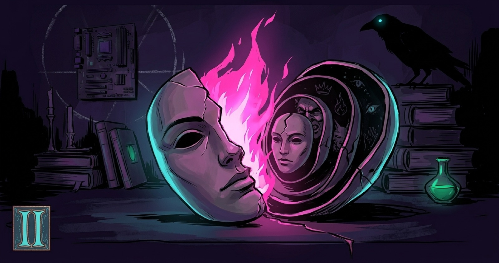
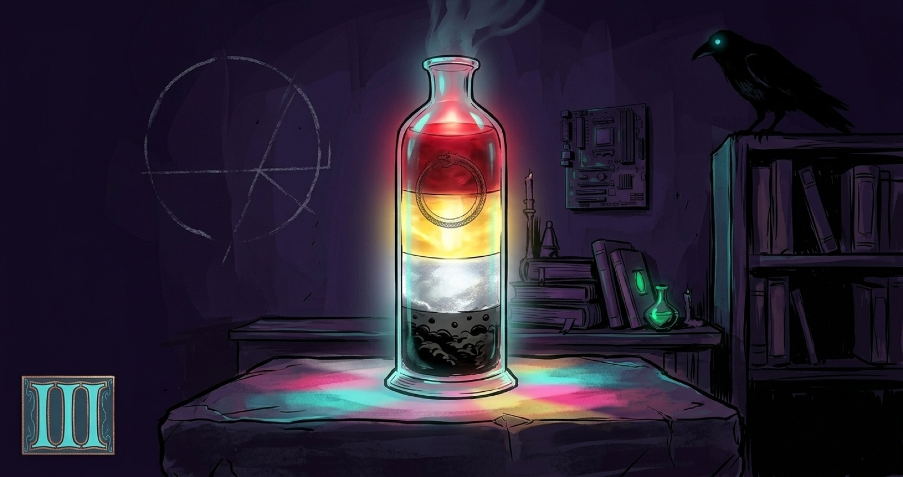
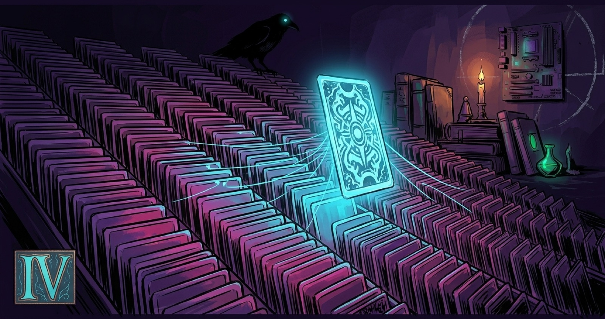
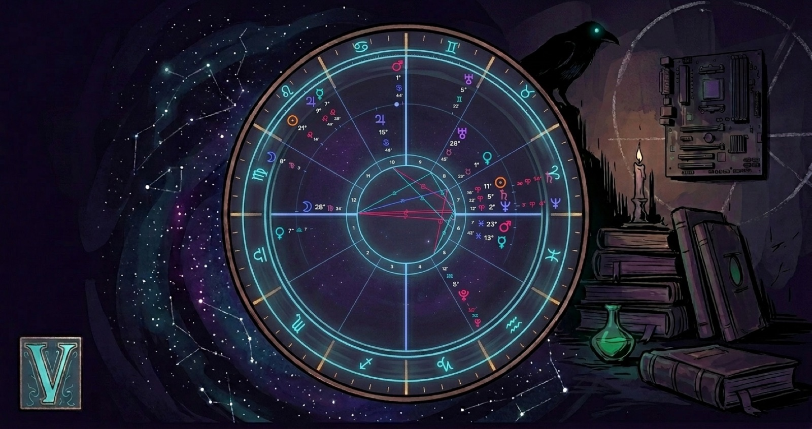
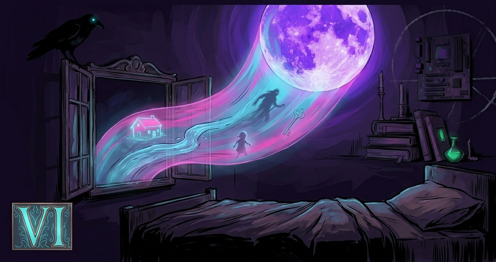
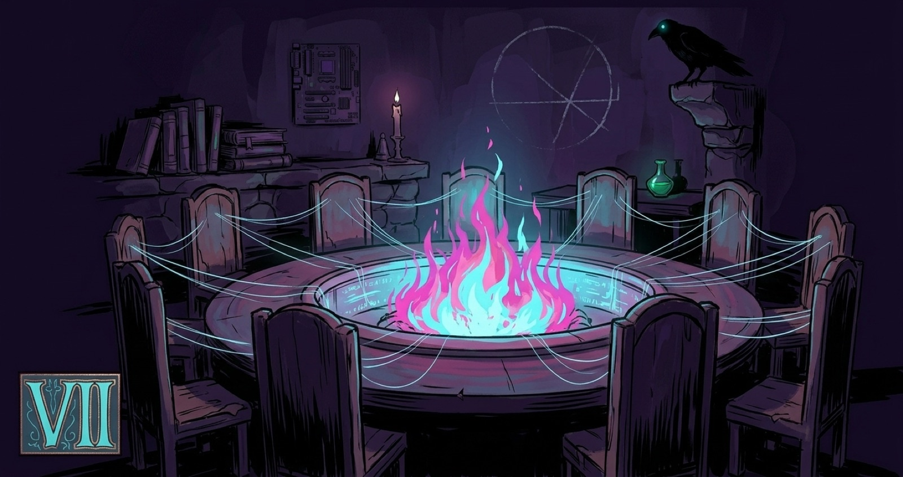
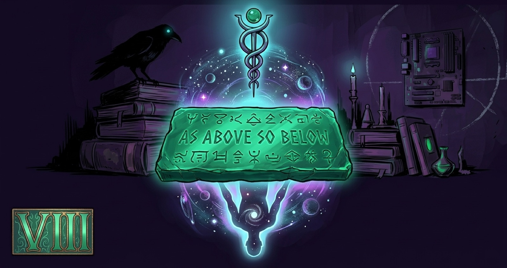
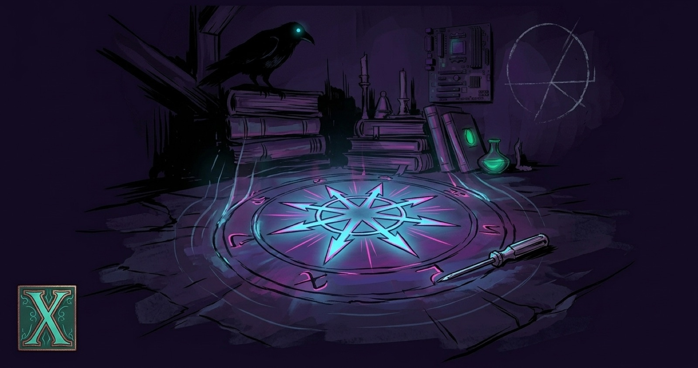

The Foundations are the on-ramp — the build-once spine of everything here. Read them **in order** the first time; the worldview comes first and everything else hangs off it. After that, this page is a shelf you **consult**, not a thing you finish — come back whenever you need to find your footing again.

There are two arcs. **Foundations I–VII** teach the whole frame: the worldview, the grammar, the three practices, and the life they add up to. The **Deeper Cuts (VIII–X)** go down into the floor under the floor — the metaphysical ground and the operative current. Read the Foundations first; the Deeper Cuts assume them.

No streaks. No rush. The work is cyclical, not linear — you'll learn that in piece three. Take them at the pace your actual life allows.

---

## The Foundations — the grammar and the practices

**I · The Mórrígan and `grep`**
**
The worldview. Two altars, one operation — pattern dragged across a field too large to read, *where does the shape land.* Why the witch and the architect were never supposed to be two people. **Read this one first; the rest hang off it.**
[Read →](/fa/the-morrigan-and-grep/)

**II · Archetype**
**
The grammar's **nouns**. The cast that actually runs the show — persona, ego, and the shadow (which is mostly your *repressed brilliance,* not your darkness), down to the collective deep where the archetypes live.
[Read →](/fa/archetype/)

**III · Alchemy**
**
The grammar's **verbs**. *Solve et coagula* and the four-stage opus — nigredo → albedo → citrinitas → rubedo — how change actually happens, in stages, in order, and why you can't skip the rot.
[Read →](/fa/alchemy/)

**IV · Tarot as Pattern-Tech**
**
The first practice. The seventy-eight-card library you *query* like `grep` — a synchronicity instrument, accurate but not literal. The deck as the grammar dealt onto the table.
[Read →](/fa/tarot-as-pattern-tech/)

**V · Astrology — the Chart and the Clock**
**
The second practice. The map you were *issued* and the sky's *clock* — the natal chart you read, the transits you time. The instrument already in your hands at every new-moon reading.
[Read →](/fa/astrology-the-chart-and-the-clock/)

**VI · Dreamwork**
**
The third practice. The one oracle that runs whether you show up or not — every night, for free. How to build the receiver, and why the dream dictionary is poison.
[Read →](/fa/dreamwork/)

**VII · Life Inside The Construct**
**
The closer. Where the grammar and the three practices stop being a syllabus and become a *life* — responsive, not scheduled; cyclical, not linear; built for the actual shape of a life, not the idealized one.
[Read →](/fa/life-inside-the-construct/)

---

## The Deeper Cuts — the floor under the floor

*The operative tier. Receptive Foundations first, then these.*

**VIII · As Above, So Below**
**
The metaphysical floor. The Emerald Tablet, the Kybalion, the oldest claim in the Western esoteric tradition — and whose god rules the whole correspondence.
[Read →](/fa/as-above-so-below/)

**IX · The Machine Is Haunted**
**
The synthesis. The empirical floor and the metaphysical floor turn out to be one house — and the machine on your desk turns out to be an altar you've been praying at without noticing.
[Read →](/fa/the-machine-is-haunted/)

**X · Belief Is a Tool**
**
The operative current, and the capstone. Where you stop *reading* the field and start *writing back* to it — chaos magick as the most ruthlessly pragmatic discipline on the whole shelf.
[Read →](/fa/belief-is-a-tool/)

---

When you forget what a word means, or you want the one book worth owning, or a snake shows up in a dream and you need somewhere to start — the **[Resource Library](/fa/the-resource-library/)** is the shelf next to this one.

Bring the whole of you. That's the entire point.

Stay feral, folks.

— Matt
