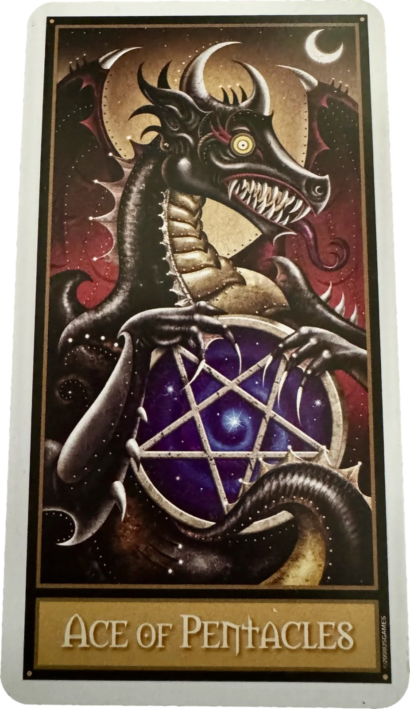
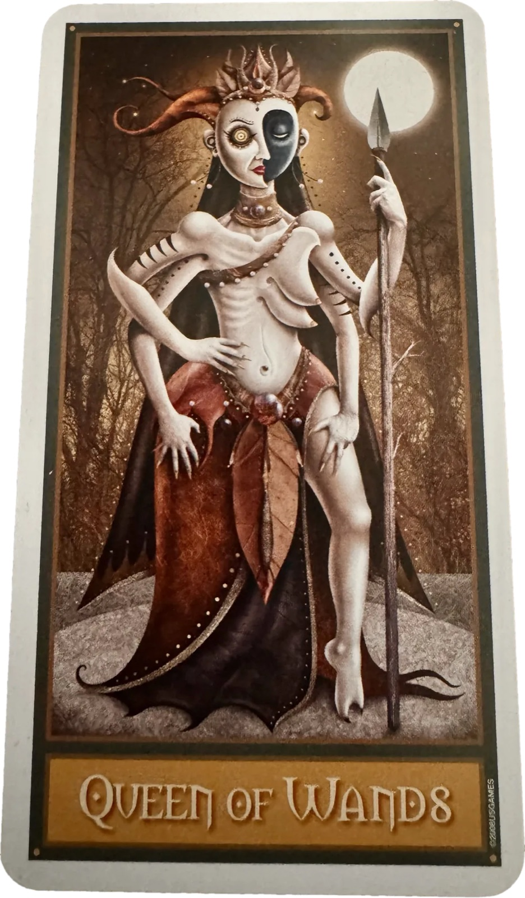

*Before we start, the thing you deserve to know. I went live on Thursday at seven, read this entire reading out loud, closed it out, and did not find out until two days later that my microphone was muted for every minute of it. Sixty-three minutes of a chart on a screen and no voice at all. There is nothing on that recording worth putting up.*

*So here is the reading itself, in full, on the page — every card, every degree, the whole through-line. I'll record it properly once I'm off the road and add it to this same post. The cards haven't moved and neither has the sky. The only thing that got lost was my voice, and you're getting it back in a form you can actually go back and re-read.*

Howdy, folks.

Welcome to the first one.

These cards went down earlier that week. Before the eclipse, not after it — I laid them reading toward it. They sat on my table for days and I walked past them, picked one up, put it back.

The chart is a different operation. That one's cast for an exact minute: 12:37 on Wednesday afternoon, Central, when the moon crossed the sun. You don't have to be anywhere to cast a chart.

This is what we do now. Thursday nearest the dark moon, the same five positions, whatever the sky happens to be doing.

One thing before I start.

**This isn't a reading for me, and it isn't a reading for any one of you. It's for the circle.** So when I say *you*, I mean all of you at once. Some of this is going to land on you hard and some of it isn't going to land on you at all, and that's not a defect. That's what reading for a room is.

## What the Lunation Spread is

Five cards. The same five positions, every single moon, forever.

**Seed** — what this moon plants. **Shadow** — what it's asking you to carry in through the gate. **Gate** — what's opening this cycle. **Ally** — what supports the work. **Work** — the craft of the cycle.

That's it. That's the ritual. The frame doesn't move; everything inside it does.

Two of those positions aren't what you'd guess.

**Shadow is not a warning.** I'm not looking for what's going to go wrong. Shadow is the disowned thing — the part you've been keeping outside the walls — and the instruction, every month, is to carry it in through the gate. Not brick it out. Bring it inside where it can be burned clean.

That's not softer than a warning. A warning hands you something to do. This hands you something to admit.

**Work is not your to-do list.** Work is craft, in the old sense of the word. Not the tasks. The skill in your hands, and the tool you're using it on.

I call it the useful blade. A blade is an honest test of a tool — it either cuts or it doesn't. Most of what fills up a week doesn't cut anything. Work is the part that does.

And there are two ways to hold one, and you want both. **Sharp hands** — you keep an edge on it, you stay good at the thing, you don't let the skill go dull. **Safe hands** — you can be trusted with something that cuts.

Sharp without safe is a hazard. Safe without sharp is a butter knife.

So the question this position asks, every single month, is: what are you actually making this cycle, and with what?

Those two phrases aren't only spread language. There's a consecration spoken over the founding members of this circle, by name — a charter, not a certificate, the difference being that a certificate says what you did and a charter says what you're for. Both phrases live inside it. Every month, this spread says the circle's own charter back to it. You'll get tired of hearing it. Good.

## The moment

Before the cards, the sky.

Wednesday, 12:37 in the afternoon, Central time.

Most people meet astrology through a birth chart — the sky at the minute you were born, and it's yours for life. This isn't that. This is the sky at the minute the moon crossed the sun. It belongs to the moment, not to a person. Not my chart. Not yours.

And you can cast one for anything. The hour you signed the lease. The afternoon you quit. A Tuesday at 10:06 for no particular reason. The sky was doing something specific at that minute, and it left a record you can go back and read.

**The moment has a chart.** This is that one.

And the first thing it says is that this was no ordinary new moon.

### One. It was a total solar eclipse.

Wednesday afternoon the moon crossed in front of the sun and put it out. Two minutes and eighteen seconds of totality at the deepest point.

The shadow came up over the Arctic, ran down across Greenland and the west coast of Iceland, out over the Atlantic, and made landfall in northern Spain right at the end of the day. Mainland Europe's first totality since 1999. Fifteen million people stood in the dark in the middle of their afternoon.

Not me. Here in Mississippi it was quarter to one in the afternoon, the sun was about as high as it gets, and nothing happened at all. An ordinary Wednesday. Full sun. While that was going on.

Twenty-six states caught some piece of it, and the District. The further north you were, the more you got. Alaska did best in the country — better than forty percent up in Nome. Northern Maine, about twenty-eight. But I know roughly where you all are, and I don't think a single one of you did much better than I did. A couple of percent at the very best, and a couple of percent is not something you notice. It's something you find out about afterwards.

So where were you at 12:37 on Wednesday? Did anything happen? I'm not fishing for a yes. *Nothing at all* is a real answer, and an interesting one.

**A bite out of the sun is not the sun going out.** Totality was a two-minute event on a strip of ground a couple of hundred miles wide, and most of that strip was ocean and ice. Even the people who caught a partial didn't see *the* thing.

**Whatever any of us saw on Wednesday, the defining event of this cycle happened somewhere we could not see it.**

An eclipse isn't special sunlight. It's geometry. A new moon that lands close to the lunar nodes lines the three bodies up well enough to put the light out. A new moon anywhere else just goes dark on its own and nobody notices. This one landed just under ten degrees off the south node. The nodes aren't a footnote on this chart. They're the main event.

### Two. The ascendant is Scorpio.

Just under eight degrees. That's the face of the moment — how this cycle arrives, the door it comes in through. Scorpio. Depth, the buried thing, what's been under the floor. Ruled by Mars, and by Pluto. This cycle does not arrive politely.

Look straight across, though. Opposite the ascendant, on the same degree, sits the descendant — Taurus, same seven-and-change.

First house and seventh aren't two separate houses. They're one axis. The ascendant is the face a thing shows up wearing; the descendant is who it's showing up *to* — what it meets, and what meets it back. You don't get one without the other.

And this one meets Taurus. Slow, grounded, fed, in no hurry whatsoever.

**It arrives Scorpio and it meets you in Taurus.** Hard door, soft hand. Intense at the threshold, gentle once you're in the room. If the front of this cycle feels like being turned inside out and the rest of it feels like being taken care of, that isn't a contradiction. That's the axis.

### Is this one yours?

One thing that's for you rather than for the chart.

Eclipses hit hardest where they touch something you already have. The rule I was taught is simple, and it's by sign. Look at your **Sun**. Look at your **Moon**. Look at your **rising sign**. And look at your own **north and south nodes**. If any of those are in Leo or Aquarius, this series is yours — not just this month, the whole run of it.

Let me do it on mine so you can see how fast it goes. Sun in Sagittarius. No. Moon in Virgo. No. Virgo rising. No. My nodes are Virgo and Pisces. No.

Four checks, four nos. **This eclipse is not mine.**

Which is a strange thing to say out loud right before I read it to you. It's also exactly why I can. I'm not standing in the middle of this one. I'm standing off to the side of it, reading it for the room.

And I haven't always been. Run the same four checks against the set before this one — the nodes only left that axis three weeks ago. It was Virgo and Pisces. Moon in Virgo, yes. Virgo rising, yes. My own nodes, Virgo and Pisces — yes, both ends of it.

Three out of four. **Those were mine.**

So I'm not off to the side of this one because I'm above it. I'm off to the side because I just got out.

Go check yours. If you came up Leo or Aquarius anywhere in those four, you're the ones this is really about.

### Testimony

One last thing before the cards.

The Greek astrologers didn't say two planets were "in aspect." They said the planets were **witnessing** each other. There's a word for it — *epimartyria*, to bear witness, the same word that turns up in the New Testament for giving testimony. An old text won't tell you Jupiter is trine Mercury. It'll say *Zeus witnessing Hermes is favorable for speech.* Or: *Mars scrutinizing the Sun harms the father.*

They aren't measurements. They're sightlines. Two planets that can see each other are giving evidence about what they've seen.

So when I say Mercury is opposite Pluto, hear it the old way: those two are staring at each other across the entire chart, and they have something to report.

**Everything from here is testimony.**

## Seed — King of Cups, reversed

Two things about eclipses in general, and then this one.

The first is the oldest thing anybody ever said about them. Historically these were read as omens — usually bad ones, but more precisely as omens of a hard shift, and specifically a shift in **leadership and public standing**. Kings. Reputations. Who's in charge, and whether they stay that way.

The second is rulership. An eclipse takes its flavour from whatever rules the sign it lands in — and this one is in Leo, which belongs to the Sun. So the Sun rules this eclipse. And the Sun is sitting right there in Leo, in its own sign, being covered up.

**The thing in charge of this eclipse is the thing getting blotted out.**

Now where it landed. **The tenth house.** Leo, twenty degrees — the house of public standing. Your visible work, your reputation, the thing you're known for. The seed of this whole cycle plants itself *in public*.

Which means the oldest read of eclipses and the house this one fell in are saying the same thing, and they were never introduced.

Now put that against the Scorpio door. **The seed plants at the top, and the only road up runs through the underworld.** Whatever's getting built this month gets built in daylight, and it gets there by way of the basement. You don't get the tenth house without the Scorpio door. That's the deal the sky is offering, and it isn't negotiable.

And it's crowded up there. That tenth house holds five bodies — Sun, Moon, Mercury, Jupiter, and the south node. A pile of Leo at the top of the chart, and you'll meet most of them again before we're through.

The midheaven is in there with them, which is worth a word, because I read whole sign houses. That means a house *is* a sign, start to finish. The tenth house here isn't a wedge with edges in the middle of nowhere — it's all of Leo.

Which does something to the midheaven. In whole sign it isn't a wall between two houses. It's a single degree, and it floats. Some charts it lands in the ninth, some in the eleventh. In this one it sits inside the tenth, at thirteen degrees of Leo — the most visible point in the chart.

And the eclipse is seven degrees over the top of it. Wide orb. But it's both lights, on the same degree, in an eclipse.

**The most exposed degree in this chart is where the light went out.**

There's one more old way of naming what an eclipse *is*, and I haven't handed it to you yet. **The moon didn't go dark on Wednesday. It made the sun go dark.**

The sun is the outer light — the visible self, the part of you with a public face on it. The moon is the inner one: feeling, the private weather, the part nobody gets a look at.

So a solar eclipse is **the inner light covering the outer one**. The private thing stood in front of the public thing and won.

That's your seed. Not a quiet beginning. A blackout — at the most exposed degree in the chart, and somewhere not one of us was standing.

**Something enormous already happened to the thing you're starting, and you weren't in the room for it.**

That's the phase you're in. Not quiet because nothing has happened. Quiet because it happened a long way off. The event is over; the news hasn't got here.

**The card is the King of Cups. Reversed.**

So the sky says Leo. Loud, public, fire, the top of the chart. And the card comes up water — and comes up upside down.

The King of Cups is the one who rules his own feeling instead of being ruled by it. A throne, and water that doesn't move him. That's the whole card. Mastery of the element you're most likely to drown in.

Turn him over and the throne goes with him. **The water ends up above the king.**

He's reversed, so the shoreline that ought to sit behind his throne now runs across the *top* of the card, above his head. The sea is over him. His robes take up almost the whole card — blue and purple and gold, scaled like something that belongs in the water rather than on a throne above it. His face is down at the bottom edge, at the lowest point of the whole image, crowned and looking away.

That's not a metaphor I brought. That's the card, turned.

And look what that puts in this position. The eclipse was the inner light covering the outer one — and the card is the ruler of the inner life, face down in his own element.

The inner thing didn't just cover the outer thing. It went under while it was doing it.

And the sky said it first, in its own language.

Both lights were in Leo on Wednesday. The Sun was at home — Leo is its own sign, it has every right to be there. The Moon was a guest. The Moon rules Cancer, not this. In Leo it holds no title of any kind: no rulership, no exaltation, nothing. Out of its own house, and with no standing in the one it was visiting.

So before a single card was turned, the sky had already put the inner sovereign off its throne.

Then the deck turned up the ruler of water — the same office the Moon holds up there — and laid him face down.

**Two systems that don't talk to each other, filing the same report.**

And all of it under the Sun's own authority. The Sun rules Leo. So it presided over both — its own light going out, and the other king going over.

Which is not the same thing as a bad king. The sovereignty is real. It's just currently underneath. Submerged, not absent.

Whatever you're starting this month is being started by somebody who can't presently get at their own command of their own feeling. And the eclipse already told us why. The thing happened offstage. You weren't in the room for it.

Of course you haven't surfaced yet.

So this position is a sequence, not a contradiction. The sky says plant it in public. The card says: **not until the king is upright.** You do not get to command the visible thing before you can command the water.

None of that is a failure. A king face-down in his own water is a month-one card.

*The seed is a king with the sea above him. Right way up is the work, not the starting condition.*

## Shadow — Three of Swords, reversed

Mercury, up in the tenth with the moon, is opposite Pluto — one degree, twelve minutes. Tight.

Mercury in the house of public standing is your voice in public. What you say, how you say it, the version of the story you tell people. And Pluto is sitting directly across from it, at the bottom of the chart in the fourth — roots, ancestry, the room in the house nobody visits. It's pulling the other way.

**The shadow this cycle is the distance between the voice you use out loud and the thing that's actually driving you.**

Not lying. That's not what this is. It's the ordinary, universal gap — the reason you gave, and the reason. The tidy version and the real one. Everybody reading this has one running right now.

And the instruction stands. Carry it in through the gate. You don't fix this by confessing it at the top of your lungs on the internet. You fix it by knowing which one is which, and letting the buried one into the room where you make decisions. Pluto's not asking to be published. Pluto's asking to be *admitted*.

**The card is the Three of Swords. Reversed.**

A heart, and three blades through it. That's the card, in nearly every deck that has one. Three *swords* — air, mind, language, the things people say — driven through the organ that feels. Mercury opposite Pluto is speech against buried depth, and the deck has handed us the image of speech going straight through the middle of a heart.

Reversed, though. And look at what reversal does to *this* one — the figure is upside down, bare feet up in the air at the top of the card, head at the bottom. Pierced, and hanging. It turns the Three of Swords into a Hanged Man. Same wound, inverted vantage, suspended.

But look at the swords.

They go through the heart *sideways* — three blades, near enough horizontal, hilts on one side and the points coming out the other. Which means the flip didn't touch them. Turn a vertical sword upside down and it points the other way; that's where "the blades are coming out" comes from. Turn a horizontal one upside down and it's still horizontal. Still through the heart. Same angle, same depth, same three.

**The person inverted completely. The swords didn't move.**

You can turn your whole vantage on a thing upside down — get the distance, get the perspective, learn to look at it from the other end — and the steel is exactly where you left it.

One thing does change, and only one: which side the hilts are on. Upright they read as going in. Reversed they read as coming out. Same blades, same heart, same angle — and the card will not tell you which way they're travelling.

From the heart's end of it, there's no difference.

**The wound is not being felt in real time.**

That's your shadow this cycle. Not a wound — everybody's got those. That's not a shadow, that's a Tuesday.

**The wound you have already finished telling people about.**

The one with a version. The one you can tell smoothly now, timeline right, lesson attached at the end, and not a damn thing moves in your chest while you say it.

That is the tidy story and the real reason, sitting in the same body. That's exactly the gap Mercury and Pluto were staring at each other about.

There are two methods here and they don't agree.

The way I was taught, an opposition is tension from *outside* — a person, a peer, someone in a power struggle with you. It's the square that runs interior. I read this one interior.

Then the Three of Swords came up, which is the most external card in the deck. It has always been about somebody else. Two, plus one.

Both are live. **Some of you are going to find your shadow in the mirror this month, and some of you are going to find it wearing a face and a name.** The card is honest that it could be either. If you're not sure which: which one did you think of first? That answer is usually the reading.

Either way, carry it in. Pluto isn't asking you to publish the wound. Pluto's asking you to stop being finished with it.

*The shadow is the wound you've already told everyone you're over.*

## Gate — Nine of Cups

Back to that midheaven, because there's something underneath it.

Jupiter. Three and a half degrees below the most visible point in the chart, and applying — still closing in. Climbing.

Jupiter is the planet of meaning. Teaching, significance, the thing that makes sense of the other things. It's the opener — expansion, the door getting wider. And it is coming up on the most public point in the sky.

**Private meaning, about to be visible.**

That's exactly where a thing like this circle lives.

And now look at what that does to that one degree. The blackout is seven degrees above it. Jupiter is three and a half below it, climbing. **The midheaven is bracketed — the thing that went out on one side, the thing that opens on the other.**

**So the gate this cycle is at the top.** Whatever's opening for you isn't opening quietly in a corner. It's opening where people can see.

But there's a second thing up there, and it's the reason Wednesday was an eclipse at all.

The south node is up there too, in that same tenth house, at twenty-nine degrees and forty-seven minutes of Leo — just under ten degrees off the eclipse. North node is what you're rising into. South node is what you're setting down. **This is a south node eclipse.** It's on the setting-down end, in Leo, in the house of public standing.

Now. Twenty-nine degrees is the last degree of a sign, and the reflex is to read that as *ending*. Something finishing. A thing halfway out the door.

Wrong, for a node. **The nodes move backward.** They walk the zodiac in reverse. A node sitting at twenty-nine degrees of Leo did not spend eighteen months crossing Leo and arrive exhausted at the far wall. It just walked in. Backward. Through the door it will eventually leave by.

Look at the dates. Two weeks before the eclipse this axis was still in Virgo and Pisces. Late July, it crossed. On the first of August it was moving forward. On eclipse day it was moving backward. It's standing on the property line, oscillating, refusing to commit to a side — on the day of the eclipse.

So this is not something public finishing. **This is the first eclipse of an eighteen-month release, and it landed in the house of being seen.** Whatever Leo material you've been carrying in public — the performance, the role, the version of you that gets applause — the sky just cracked open an eighteen-month window for setting it down. You're at the front of that. Not the back.

Do you know what your Leo thing is? The public version of yourself you've been hauling around. What happens if you set it down?

Sit with that one. It's the question this whole cycle is built on.

Nine years ago — August 2017. The eclipse that crossed America, the one everybody drove eight hours to stand under. Sun at twenty-nine degrees of Leo. And the **north** node in Leo.

Same sign. Opposite end.

That eclipse was about rising *into* the Leo thing: be seen, build the platform, put your name on it, make yourself into a brand. The nodal cycle runs about nineteen years, so nine is the halfway mark.

And here we are. Same sign. Other node.

**2017 handed out the assignment. This one is the invoice.**

Now the mechanism, because "release" makes it sound like things quietly drain off. They don't.

A south node **magnifies whatever it touches before it takes it.** It enlarges the thing — bigger, louder, more visible, more obviously itself — and *then* sweeps it away. The swelling is part of the removal.

So expect the Leo thing to get **louder before it goes.** The role, the performance, the public version of you — this may be the month it gets the most attention it has ever had.

That is not the sky changing its mind. That's the south node showing you the full size of what you're about to set down. You don't get to release something you never got a good look at.

And that's what a nodal moment actually is. Not a door in a wall. A **garden gate**. You walk through, the wheel turns, and you are in the next section of the story — and a gate is only ever open for so long.

One number to correct, because I keep saying eighteen months. That's how long the nodes sit in Leo and Aquarius. The eclipse series that runs with them goes on into 2028. So: eighteen months for the window, and the better part of two years for the weather.

**The card is the Nine of Cups.**

Upright. The wish card.

The Nine of Cups is the one everybody wants to pull. Nine cups, set out on display, and a figure in front of them who is thoroughly pleased with the arrangement. It means the thing you wanted. Not hoped for — *got*. Satisfaction, delivered, and set out where it can be admired.

And then look at how *this* deck draws it, because it doesn't draw a satisfied person. It draws the wish actually being granted.

Down at the bottom of the card, small, sitting on the sand by the water in a red suit and pointed shoes, there's a figure holding **a lamp**. And rising out of the lamp, filling the top two-thirds of the card — blue, enormous, arms folded, three eyes in its face and one of them shut, nine gold cups drifting in the air around it — is **a djinn**.

Three things about that.

**One. You rubbed the lamp.** Nobody did this to you. The thing towering over that little figure in the jester's shoes is there because it was *summoned*, and the summoning was a wish, and the wish was granted. Whatever public Leo thing you're being asked to set down over the next eighteen months — you asked for it. That's not an accusation. It's the difference between grief and regret.

**Two. A djinn grants the wish exactly as you said it.** Not as you meant it. Exactly as you said it. Every one of you who has ever gotten precisely the thing you requested knows the specific flavor of that, and it is not the flavor you expected in the shop.

**Three. A djinn is *smoke*.** That's what it's made of. And smoke is the only thing in the world that gets **bigger at the exact moment it begins to disappear.**

That's the south node. That's the entire mechanism I just described, and the deck drew it, without being asked, as vapor coming out of a lamp.

It sounds crueller than it is.

**The thing you're setting down is not a burden. It's the thing you asked for and received.**

Which is why it takes eighteen months. Nobody needs eighteen months to put down something they hated.

You need eighteen months to put down the wish that came true. The public version of yourself that *worked*. The role that got you applause you actually fucking wanted.

Nine cups, set out on display — and look at where that table is. The tenth house. This is a satisfaction that was arranged for people to see.

2017 said: be seen, build the thing, put your name on it. You did. **The Nine of Cups is the receipt.**

And the magnification is the mercy in it. You get the banquet before you get the bill.

Between now and the far side of this, the wish gets its fullest, loudest, most complete expression. That's not the universe taunting you. That's the only way anybody ever gets to see the whole size of a thing they've been standing inside of.

You cannot set down what you never got a good look at. **This is the good look.**

Enjoy it. Honestly. The lamp is still in your hand and it is small and ordinary and sitting on the ground with you, and it will be there long after the smoke has gone.

*A djinn is smoke. Smoke gets bigger as it disappears.*

## Ally — Ace of Pentacles

Saturn, in the sixth house, trine the midheaven. One degree, twenty-two minutes, applying.

The sixth house is the least glamorous room in the chart. It's routine. Daily work. The stuff you do on Tuesday that nobody claps for. Maintenance, health, craft, the fifteen minutes.

And Saturn — the planet everyone's been taught to dread — is sitting in there sending a *trine* to the top of the chart. A trine is the easy angle. The supported one.

And not just the top of the chart generally. That midheaven is the degree the eclipse went out over. Saturn's easy angle lands on the exact point where the light failed.

**Your ally this cycle is the boring thing you already do.**

The chart is saying that what holds up the public seed is the private routine. Not a new system. Not a better plan. The one you've already got, done on the days you don't feel like it. Saturn is only cruel when you're avoiding him. In the sixth house, trine the midheaven, applying — he's the strongest friend in this chart.

And he isn't the only easy angle in it. There's a whole figure of them, and it's the only complete figure in the chart.

Three planets, each a third of the way around the wheel from the next. Venus in Libra. Uranus in Gemini. Pluto in Aquarius. A triangle — a grand trine. Three easy angles closing on themselves. The most stable shape there is.

All three are air signs. Air is mind, language — the thing you think and the thing you say.

Now look at the houses they're in. Twelfth. Eighth. Fourth. The three most submerged rooms in any chart: the hidden, the buried, the basement. And Pluto's corner you already met — down in the fourth. That was the shadow.

**The one thing in this chart that's working perfectly is happening entirely out of sight.**

And Venus is the reason it exists at all. Uranus and Pluto are slow — they've been holding that angle for years and they'll hold it for years more. That's a whole generation's weather, and it isn't about this month. Venus is in Libra for about four weeks. She walked in, closed the triangle, and she'll walk back out. Which makes this figure *ours* rather than the decade's.

And Libra is her own sign. Venus rules it. She's home, in full command of her own house.

Hold that against the Sun. The Sun was also in its own sign on Wednesday — Leo, its own rulership, every right to be there. And it got put out.

**Two rulers at home in this chart. One of them was extinguished. The other one is fine.**

So the support here is real, it's load-bearing, and there is more of it than one planet.

One catch, and it's one this reading is going to hand you again before we're done. A grand trine is a closed circuit. It flows so well it doesn't need you. And hers is in the twelfth house.

**The mercy in this chart is real, it is structurally sound, and it is sitting in the rooms you never go into.** It is not going to come and find you.

**The card is the Ace of Pentacles.**

Saturn in the sixth house, and the deck answers with the Ace of the earth suit. Same statement twice, in two languages, and when that happens you stop looking for cleverness and say the thing.

Except this deck did something to the Ace of Pentacles.

In most decks the Ace of Pentacles is a hand coming out of a cloud, politely offering you a coin. Gentle. Free. Here? **There is a dragon on it.** A black, horned, scaled dragon with its wings up and its teeth out, coiled around the pentacle, staring straight at you.

And *that's* the truth about the boring thing you already do.

Because I said your ally this month is the routine, the fifteen minutes, the Tuesday nobody claps for — and every one of you heard that and thought, *sure, fine, easy.*

It isn't easy. If it were easy you'd already be doing it.

**The coin is guarded.** There's something with teeth sitting on top of the daily practice, and it is the exact reason you don't do the daily practice, and it is not laziness. It's dread.

It's the thing that makes a fifteen-minute task feel like it weighs forty fucking pounds.

Saturn is only cruel when you're avoiding him. The card drew you the avoidance, in scales, so you'd stop mistaking it for a character flaw.

There's one wrinkle worth having, though. The sky said *the routine you already have* — not a new system, not a better plan. And an Ace is a beginning. So which is it, the old practice or a new one?

Both. **A daily practice is an Ace of Pentacles you draw again every single morning.** That's what a daily practice *is*. It isn't one decision that then coasts. It's a first day, and then another first day, and then another one on the day you don't feel like it. The Ace isn't announcing a new regime. The Ace is what Tuesday looks like when you actually show up for it.

And look at what the dragon is actually doing with it. Not swallowing it. Not sitting on it. Holding it up — claws around the rim, the whole disc turned to face you. It's being *held out*. Not a coin you own — a coin being presented, by something with teeth. Which means it has to be taken, every time, and it's just as available on the day you walk past it.

*There's a dragon on the daily practice. That's not a character flaw. That's the card.*

## Work — Queen of Wands

Two near-perfect sextiles, and they're the tightest aspects in the whole chart that actually mean anything.

Mercury sextile Uranus — twenty-three hundredths of a degree. Mars sextile Chiron — eight hundredths. Those are effectively exact.

Mercury and Uranus can see each other, and what they're giving testimony about is speech. The disruptive thing, said out loud. The idea that breaks the frame, actually spoken, not just had in the shower. Mars and Chiron is action taken from the wound — not around it, not despite it. From it.

**The craft of this cycle is saying the disruptive thing, and moving from the sore place.**

Both of these are sextiles, and the aspect is carrying as much as the planets. A sextile is an opportunity, not a compulsion. Nothing here is going to force you. A square would drag you into it. A sextile opens a door and waits, and if you don't walk through it, it closes and nothing happens, and no one will ever tell you what you missed.

**The card is the Queen of Wands.**

Upright. Fire, held by someone who knows how to hold it.

The Queen of Wands doesn't work at being magnetic. She's the one in the room everybody orients toward without being asked to, and she isn't performing — she's entirely, unapologetically at home in her own heat.

And this deck's Queen is not warm. She's pale as chalk, bare from the waist up, crowned in something that reads as flames or antlers depending on how long you look at it, holding a spear rather than a wand — a spear, with a point on it — and standing under a full moon.

Two things on that face. **She has one dark eye and one light one.** Half of her is looking at you out of the shadow and half of her is looking at you out of the light, at the same time, and neither half is apologizing.

That's the Shadow position's instruction showing up in the Work position's card. Carry it in through the gate. She didn't carry hers in — she's *wearing* it, in her face, and she's still holding the spear.

And she is standing under a full moon on the darkest night of the month. Whatever light she's got, she isn't getting it from this sky.

Now — a sextile opens a door and waits, and won't drag you through it. There's a version of that method that goes further and calls the easy aspects useless. Marshmallows. Soft, sweet, and no damn good for cutting anything. You can't carve marble with a trine; you need the squares and the oppositions, the hard ones, the friction — those are the blade.

I chewed on that all week, and then this card came up and answered it.

**A sextile won't drag you. She doesn't need dragging.**

The easy aspects are only useless to people who require force.

The disruptive thing said out loud, the move made from the sore place — both doors are standing open this month, and neither one is coming to get you. The Queen of Wands is the figure who walks through an open door without being asked twice.

That's the craft of this cycle. Not the courage to break something. The rarer thing: the willingness to take an offer.

One more, and it's about the Thursday rather than the Wednesday. When the moon was new it was in Leo. It isn't now. It crossed into Virgo at eighteen minutes past five on Thursday morning, Central — shift that for wherever you are — and it was sitting at eight degrees by the time I read this.

Out of the roar and into the workshop, before any of us were up. Virgo is discernment, precision, the craft that actually cuts.

So the card is fire and the sky is earth, and that's not a fight. **That's how you make a blade.** Forged in the one, finished in the other. Sharp hands, safe hands.

*A sextile won't drag you. She doesn't need dragging.*

## The through-line

Let me put the whole thing in one shape.

The seed was planted in public and in the dark, and the dark was manufactured — the moon put the sun out, and did it somewhere none of us could see. The way in is the basement. Scorpio's on the door.

The shadow is the gap between what you say and what's actually driving you, and the instruction is to admit it, not announce it.

The gate is at the top of the chart, wide open, and it's the front end of an eighteen-month release — not a one-night toll.

The ally is the boring routine you already have, with a dragon sitting on top of it.

And the work is saying the disruptive thing and moving from the sore place, through a door that will not drag you through it.

**The seed plants itself at the top of the chart, and the only way up is through the underworld.**

Eclipses have always been underworld business. Oldest read there is. The light goes out. Something gets taken. Something comes back different. On Wednesday the light actually went out.

There are two clocks running on this. The lunar one is twenty-nine and a half days, and that's the one we pick back up on the tenth of September. The nodal one is about eighteen months. **This is day one of both.**

And then the cards put a spine through it that I did not have before I laid them down.

Start with what actually got eclipsed. Fire. The Sun, in fire's own sign, in the house of being seen — put out.

Now look at the last card in the spread. The Queen of Wands. Fire. Upright, fully in command, standing lit under a full moon on the darkest night of the month.

**The light that went out at the seed is standing up at the work.** Same element. Different body. This one holds a spear and wears her shadow in her face.

And there's a second cycle running underneath that one. The first card is a king face down in his own water; the last is a queen upright in her own fire. Two sovereigns, opposite elements — one who can't reach his command, and one who *is* her command.

Everything in between is the road from one throne to the other. The wound you've stopped feeling, admitted. The wish you got, enjoyed, and then set down. And one coin, held out by a hand, every single morning, whether or not anybody's watching.

And the chart ran that same pair, on its own. Two planets were at home on Wednesday — the Sun in Leo, Venus in Libra. Both in their own signs. Both with every right to be there. One of them got put out. The other one is still standing, holding the only whole figure in this chart together, down in the rooms nobody looks at.

**Two systems that don't talk to each other, filing the same report.** Again.

Five cards: water, air, water, earth, fire. All four elements turned up. This month isn't asking for one part of you — it wants the whole instrument, and it leans wet.

One last thing, now that all five are down.

Three different mechanisms in this reading are saying the same sentence. The Sun ruled the sign it was blotted out in, so it presided over its own darkening. The south node swells a thing before it takes it, so you get the whole look before you lose it. And the djinn came out of a lamp that somebody rubbed.

**Nothing here is being done to you.** Every piece of it is being released by its own authority.

That is a harder cycle than being robbed. It is also a much better one.

## The founding

One more thing, and it's the reason this isn't just the first of twelve.

Everyone in this circle who took a Construct seat before the new moon came in as a Feral Founder. That was the offer, and the offer had three parts: the rate locked for as long as you keep the seat, your name among the first, and a consecration spoken over you. By name. Out loud. Once.

The door closed with the moon. The list is closed at two, and it doesn't get added to.

I spoke that consecration on Thursday night, and the mic ate it. So it doesn't count. *Out loud* and *once* are the two words in that promise doing the actual work, and a page can't carry either of them.

It gets spoken in the recording. By name, out loud, once, the way it was offered.

The circle stays open — it was always going to stay open — but the founder's mark closed with the moon, and the moon doesn't move for anybody.

## Before the next one

One thing for your calendar, and this one you can walk outside and look at.

The night of the twenty-seventh, there's a lunar eclipse in Pisces. It goes deepest a little after eleven, Central; shift that for wherever you actually are. Ninety-six percent of the moon inside the earth's shadow. Damn near total.

And this one, unlike Wednesday's, you can actually see. Most of the Americas, plus Europe and Africa. A lunar eclipse doesn't need you to be standing in one particular field — it just needs the moon to be up.

Eclipses come in pairs. Solar and lunar, about two weeks apart, and they talk to each other.

The solar one was in Leo. This one's in Pisces — which is *not* the opposite sign, and that isn't a typo in my notes. Out-of-sign pairs happen when the nodes are mid-move between signs, which is exactly what's going on right now.

It's the signature of a hinge. Things feel upended in these stretches, and people tend to blame themselves for it.

Consider that a forecast.

So: the one you couldn't see opened the cycle. The one you can see closes the season. Go stand outside on the twenty-seventh.

The next reading is the tenth of September — second Thursday, seven o'clock, same five positions, whatever the sky's doing by then.

One ask before you go, and it's a real one. What landed, and what didn't? Which position went straight through you, and which one slid off? Hit reply and tell me. This is the first of twelve, and I'd genuinely rather know.

Stay feral, folks.
